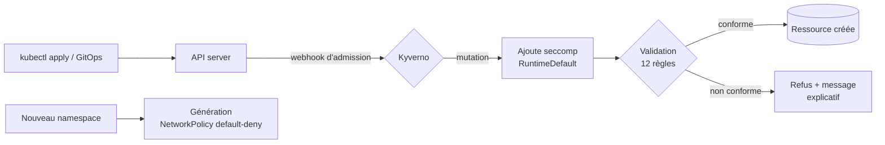

# k8s-policy-as-code

[](https://github.com/voidsponge/K8S-Policy-as-Code/actions/workflows/policy-tests.yml)
[](https://github.com/voidsponge/K8S-Policy-as-Code/actions/workflows/e2e.yml)

Des règles de sécurité Kubernetes écrites **en code**, testées comme du code, et appliquées
automatiquement par le cluster grâce à [Kyverno](https://kyverno.io).

Un développeur qui essaie de déployer un conteneur privilégié, une image `latest` ou un Pod
sans limite mémoire voit son `kubectl apply` **refusé**, avec un message qui explique pourquoi
et comment corriger. Personne n'a besoin de relire le YAML à la main.

## Pourquoi « Policy as Code » ?

Les mauvaises configurations sont la première cause d'incidents de sécurité sur Kubernetes :
un `privileged: true` copié depuis Stack Overflow, un `hostPath` qui monte le socket du runtime,
une image tirée d'un registre inconnu. Une checklist dans un wiki ne bloque rien.

Ici, chaque règle est :

- **versionnée** dans git, relue en pull request comme n'importe quel code ;
- **testée** : des Pods conformes et non conformes vérifient que la règle bloque ce qu'elle doit
  bloquer, et seulement ça ;
- **appliquée à l'admission** : l'API Kubernetes interroge Kyverno avant de créer une ressource ;
- **validée sur un vrai cluster** à chaque push, dans GitHub Actions.



## Les policies

| Policy | Type | Ce qu'elle empêche | Sévérité |
|---|---|---|---|
| [`disallow-privileged-containers`](policies/pod-security/disallow-privileged-containers.yaml) | Validation | Conteneur privilégié = accès root au nœud | Haute |
| [`disallow-privilege-escalation`](policies/pod-security/disallow-privilege-escalation.yaml) | Validation | Élévation de privilèges via binaires setuid | Haute |
| [`require-run-as-non-root`](policies/pod-security/require-run-as-non-root.yaml) | Validation | Conteneur qui tourne en root | Haute |
| [`disallow-host-namespaces`](policies/pod-security/disallow-host-namespaces.yaml) | Validation | `hostNetwork`, `hostPID`, `hostIPC` | Haute |
| [`disallow-host-path`](policies/pod-security/disallow-host-path.yaml) | Validation | Montage de fichiers du nœud (socket containerd…) | Haute |
| [`require-drop-all-capabilities`](policies/pod-security/require-drop-all-capabilities.yaml) | Validation | Capabilities Linux superflues (`SYS_ADMIN`, `NET_RAW`…) | Moyenne |
| [`require-readonly-root-filesystem`](policies/pod-security/require-readonly-root-filesystem.yaml) | Validation | Dépôt de binaires dans le conteneur | Moyenne |
| [`restrict-seccomp`](policies/pod-security/restrict-seccomp.yaml) | Validation | Profil seccomp `Unconfined` | Moyenne |
| [`add-default-seccomp-profile`](policies/pod-security/add-default-seccomp-profile.yaml) | **Mutation** | Ajoute `RuntimeDefault` si aucun profil n'est défini | Moyenne |
| [`disallow-latest-tag`](policies/supply-chain/disallow-latest-tag.yaml) | Validation | Image `latest` ou sans tag (non reproductible) | Moyenne |
| [`restrict-image-registries`](policies/supply-chain/restrict-image-registries.yaml) | Validation | Images de registres non approuvés, typosquatting | Haute |
| [`require-resource-limits`](policies/best-practices/require-resource-limits.yaml) | Validation | Déni de service par épuisement mémoire du nœud | Moyenne |
| [`require-labels`](policies/best-practices/require-labels.yaml) | Validation | Workloads sans propriétaire identifiable | Basse |
| [`add-default-deny-networkpolicy`](policies/multi-tenancy/add-default-deny-networkpolicy.yaml) | **Génération** | Trafic libre entre namespaces : chaque nouveau namespace reçoit une NetworkPolicy default-deny | Moyenne |

Les règles visent les Pods, mais Kyverno génère automatiquement leurs équivalents pour les
`Deployment`, `StatefulSet`, `DaemonSet`, `Job` et `CronJob` (*autogen*). Un Deployment non
conforme est donc refusé **immédiatement**, au lieu de créer un ReplicaSet dont les Pods
échoueraient en silence.

Les namespaces système (`kube-system`, `kyverno`, `local-path-storage`) sont exclus : certains
composants du cluster ont légitimement besoin de privilèges.

## Trois niveaux de tests

| Niveau | Outil | Ce qui est vérifié | Où |
|---|---|---|---|
| Lint | yamllint | Syntaxe et style de tout le YAML | [`policy-tests.yml`](.github/workflows/policy-tests.yml) |
| Unitaire | `kyverno test` | **72 cas** : pour chaque règle, des Pods qui doivent passer et d'autres qui doivent échouer, le résultat de la mutation, la ressource générée, l'autogen sur Deployment et CronJob, l'exclusion de `kube-system` | [`tests/`](tests/) |
| End-to-end | kind + Helm + kubectl | Kyverno installé dans un **vrai cluster** : 12 manifests dangereux refusés par la bonne policy, mutation et génération observées, application de référence déployée jusqu'à `Ready` | [`e2e/`](e2e/), [`e2e.yml`](.github/workflows/e2e.yml) |

Chaque manifest de [`e2e/denied/`](e2e/denied/) ne viole **qu'une seule** règle, et déclare
laquelle doit le bloquer (`# expect: …`). Le test échoue si le manifest passe, mais aussi s'il est
refusé par une autre policy que celle attendue : on vérifie que chaque règle fait son travail,
pas seulement que « quelque chose » bloque.

Les tests ont aussi été vérifiés dans l'autre sens : en affaiblissant volontairement une règle
(par exemple en acceptant `*registry.k8s.io*` au lieu de `registry.k8s.io/*`), le cas de
typosquatting `registry.k8s.io.evil.com/pause` passe et le test échoue.

## L'application de référence

[`examples/secure-app/`](examples/secure-app/) contient un Deployment qui respecte toutes les
règles. C'est le modèle à copier pour un nouveau service : utilisateur non root, système de
fichiers en lecture seule avec un `emptyDir` pour `/tmp`, toutes les capabilities retirées,
seccomp, limites de ressources, image figée, token de service account non monté.

Son namespace active aussi le niveau `restricted` de
[Pod Security Admission](https://kubernetes.io/docs/concepts/security/pod-security-admission/),
le contrôle natif de Kubernetes : **défense en profondeur**, deux mécanismes indépendants
doivent être contournés.

## Lancer en local

Prérequis : [Kyverno CLI](https://kyverno.io/docs/kyverno-cli/), et pour l'e2e Docker,
[kind](https://kind.sigs.k8s.io/), kubectl et Helm.

```bash
make test       # tests unitaires, sans cluster (quelques secondes)
make cluster    # cluster kind + Kyverno
make e2e        # tests d'admission sur le cluster
make clean      # supprime le cluster
```

Vérifier un manifest avant de le déployer, sans cluster :

```bash
kyverno apply policies/ --resource mon-deployment.yaml --table
```

La démonstration pas à pas est dans [docs/demo.md](docs/demo.md).

## Sécurité de la CI

Mêmes principes que pour le code applicatif :

- **Actions épinglées par SHA de commit**, mises à jour par Dependabot.
- **Versions figées** : Kyverno CLI `v1.18.1`, chart Helm `3.8.1`, kind `v0.33.0`, yamllint `1.37.1`.
- **Somme de contrôle vérifiée** à l'installation de la CLI Kyverno (`checksums.txt` de la release).
- **Permissions minimales** : `contents: read` uniquement, `persist-credentials: false`.
- **Timeouts**, `concurrency` et **exécution hebdomadaire** de l'e2e pour détecter une régression
  même sans commit.

## Pistes d'évolution

- Vérification des signatures d'images avec Cosign (`verifyImages`) pour n'accepter que des
  images signées par la CI.
- Passage en mode `Audit` sur un cluster existant pour mesurer l'écart avant d'appliquer
  `Enforce`.
- Exceptions ciblées et tracées avec `PolicyException` plutôt que des exclusions larges.
- Déploiement des policies par GitOps (Argo CD ou Flux).

## Structure

```
policies/            les ClusterPolicies Kyverno, par catégorie
tests/               tests unitaires kyverno test (un dossier par policy)
e2e/run.sh           tests d'admission sur un vrai cluster
e2e/denied/          un manifest dangereux par règle
examples/secure-app/ déploiement de référence conforme
```

## Licence

MIT
